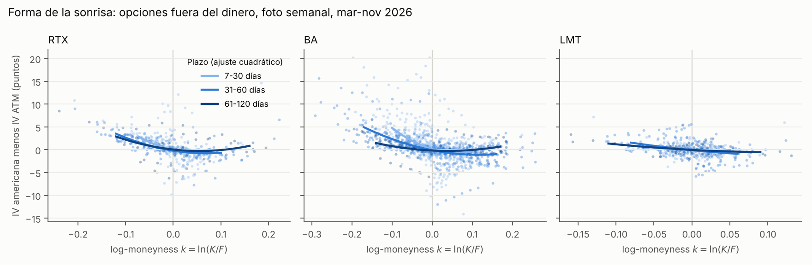
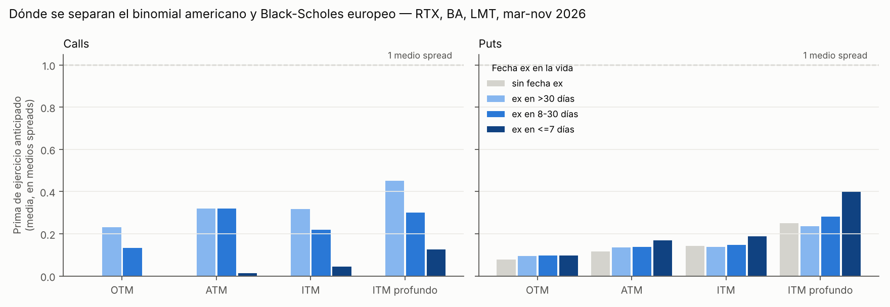
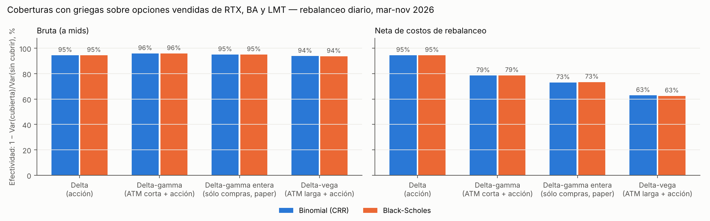
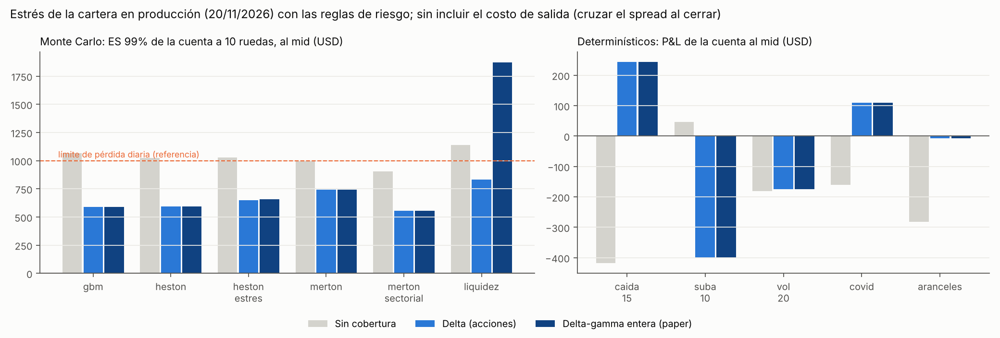

# Resumen

En la entrega parcial reportamos un P&L simulado de USD 19.055 con 97,8% de
acierto. La devolución identificó el problema: el bid y el ask eran
**sintéticos**, construidos alrededor de cierres que no son simultáneos, y la
paridad put-call trataba el dividendo como un yield continuo. Este informe
reemplaza esos resultados. Todos los números salen de los archivos de
`reportes_dolthub/`, que se reproducen con los scripts del repositorio.

Los hallazgos centrales son cuatro.

1. **Con bid y ask observados no hay arbitraje model-free ejecutable.** Sobre
   181 ruedas de la foto diaria de DoltHub (marzo a noviembre de 2026, 95.290
   cotizaciones), los detectores de monotonicidad, cota vertical, butterfly y
   calendario no encuentran **ninguna** violación. La paridad encuentra 1.744.
2. **Esas violaciones de paridad son desfase horario, no arbitraje.** La foto
   de DoltHub se toma durante la rueda y el spot de referencia es el cierre.
   Cotizando la acción en una banda del tamaño del desfase medido, las 1.744
   violaciones bajan a 3, y ninguna sobrevive a la ejecución en la rueda
   siguiente. El dividendo discreto, por su parte, elimina el 41% del edge
   fantasma de LMT en las tres semanas previas a cada fecha ex.
3. **El binomial calibrado reproduce la cadena dentro del bid-ask.** Una
   sonrisa cuadrática por vencimiento revalúa en el árbol entre el 82% y el
   94% de las opciones fuera del dinero dentro del spread, con un error
   mediano de 0,2 a 0,3 medios spreads.
4. **La estrategia de valor relativo contra el modelo pierde fuera de muestra,
   y sabemos por qué.** Publicar órdenes límite al precio del modelo menos un
   margen se llena sólo cuando el mercado atraviesa el modelo: es selección
   adversa. En el walk-forward (calibración marzo-junio, evaluación mes a mes
   de julio a noviembre) ninguna configuración alcanza un Sharpe deflactado
   de 0,95, y con más órdenes por rueda las 36 configuraciones pierden.

La estrategia de valor relativo, de payoff acotado y tamaño mínimo, es la que
corre en paper trading, porque es la única que genera posiciones sobre las que
la Parte 2 puede comparar el binomial contra Black-Scholes en producción.

La Parte 2 (secciones 7 a 13) agrega cuatro resultados.

5. **El binomial reprecia mejor que Black-Scholes, pero por poco.** Con el
   mismo dividendo discreto en los dos modelos, sobre 36.515 contratos, el
   test de Diebold-Mariano favorece al binomial ($DM^* = 13{,}1$) justo donde
   la teoría lo predice: puts dentro del dinero y calls con fecha ex. La prima
   de ejercicio anticipado supera medio spread sólo en el 0,3% de los
   contratos.
6. **La cobertura que conviene es delta con acciones.** Sobre 3.272
   días-posición reduce la varianza diaria 95%, igual neta de costos;
   cubrir también la gamma con opciones gana un punto bruto y pierde 16 netos.
   Las griegas de los dos modelos dan la misma cobertura.
7. **En el estrés manda la liquidez.** La cobertura delta baja el ES 99% de la
   cartera en producción entre 25% y 45% en GBM, Heston y Merton; cerrar todo
   cruzando el spread cuesta más que cualquier escenario de mercado. El estrés
   además encontró que el kill-switch en vivo se disparaba al abrir cada
   posición; se corrigió.
8. **Decisión, con criterios fijados antes del paper:** binomial y cobertura
   delta, con la salvedad de que la ventaja del binomial es estadística más
   que económica (sección 11).

# 1. Qué cambió respecto de la entrega parcial

| Devolución | Qué hicimos | Dónde |
|---|---|---|
| 1. Bid/ask real | Descarga de 181 ruedas de DoltHub con bid y ask observados; ejecución contra esos precios | `scripts/download_dolthub.py`, `ita_options/dolthub.py` |
| 2. Paridad con dividendos discretos y fondeo | Cotas americanas con dividendo discreto, fondeo asimétrico, dividendos point-in-time y banda de spot; carry y asignación anticipada en el backtest; corregido un error de signo en el préstamo de la acción | `ita_options/arbitrage.py`, `ita_options/backtest.py` |
| 3. Paper trading | Valor relativo contra el binomial en verticales y butterflies, orden multipata límite, 1 unidad, vencimientos de diciembre en adelante | `ita_options/execution/model_rv.py` |
| 4. Split IS/OOS | Walk-forward con ventana creciente desde marzo-junio y evaluación mes a mes | `ita_options/rv_backtest.py` |
| 5. Ajuste de la calibración | Sonrisa paramétrica, IV contra moneyness y plazo, RMSE de repricing dentro y fuera de muestra | `scripts/run_calibration.py` |
| 6. Monitoreo como proceso | El loop `paper-run` corre toda la rueda: marca, reconcilia el ledger con el broker y aplica los cortes sobre posiciones reales | `ita_options/execution/live_runner.py` |
| 7. Una sola versión | Este informe; la entrega parcial quedó archivada en `entrega_parcial_sep/` | — |

Además, la revisión del código encontró un error que la devolución no
mencionaba: en la conversión reversa, el costo de préstamo de la acción
**sumaba** al crédito en lugar de restar, y el medio spread de la acción tenía
el signo invertido en las dos cotas. Ambos inflaban justamente las paridades,
que eran el 87% del P&L de la entrega parcial.

# 2. Datos

## 2.1 Fuente

Alpaca no ofrece histórico de cotizaciones de opciones, y el plan gratuito de
Polygon sólo da velas. El recorder propio que planeamos en septiembre no llegó
a grabar. La fuente de bid y ask observados es la base pública
`post-no-preference/options` de DoltHub: una foto diaria de la cadena con
bid, ask, volatilidad implícita y griegas del proveedor.

| Concepto | Valor |
|---|---|
| Período | 2 de marzo a 20 de noviembre de 2026 |
| Ruedas pedidas / con datos | 185 / 181 |
| Ruedas sin datos en DoltHub | 1, 13 y 14 de mayo; 29 de septiembre |
| Cotizaciones | 95.290 (LMT 35.600, BA 31.034, RTX 28.656) |
| Vencimientos | hasta 200 días |
| Spot | cierre diario sin ajustar por dividendos (Yahoo) |
| Tasa libre de riesgo | letra a 13 semanas (^IRX), diaria; entre 3,56% y 4,15% |
| Dividendos | Polygon (con fecha de declaración) y Yahoo |

La descarga hace una consulta por rueda con los tres subyacentes, en paralelo
y con caché, y reintenta los timeouts del servidor. Las cuatro ruedas vacías
siguieron vacías en un segundo intento: son huecos de la base.

## 2.2 Curación y filtros

Cada fila se sella a las 16:00 de Nueva York de su rueda, y una señal de la
rueda $t$ se ejecuta contra la foto de $t+1$ o $t+2$. DoltHub no publica
volumen ni open interest: se reporta su ausencia, pero no se la trata como
cero ni como liquidez, y la liquidez se juzga por el spread.

| Criterio | Filas excluidas |
|---|---:|
| Spread relativo $\ge 25\%$ | 38.773 |
| Bid nulo | 7.505 |
| Mid menor a USD 0,05 | 269 |
| Cotización cruzada | 25 |
| **Explotables** | **56.492 de 95.290 (59,3%)** |

El spread relativo mediano es 18,5%. El umbral de 25% (15% en la entrega
parcial) se eligió porque con 15% se descarta más de la mitad de la cadena.

## 2.3 Desfase entre la foto y el cierre de la acción

DoltHub no documenta la hora de la foto. Para medir cuánto se separa la cadena
del cierre de la acción, en cada rueda y subyacente se estima el spot
implícito por paridad en los pares cercanos al dinero ($|\ln K/S| \le 3\%$,
entre 7 y 60 días):

$$\hat S_t = \operatorname{mediana}_{K \approx S}\left(C^{mid}_K - P^{mid}_K + K e^{-r\tau} + D\right)$$

La mediana usa en promedio 15 pares por rueda. La brecha
$|\hat S_t / S_t - 1|$ tiene mediana 0,19% y percentil 90 de 1,26%: hay días en
que la cadena cotiza contra un spot varios dólares distinto del cierre. Ese
desfase define la incertidumbre del spot, $u_t = |\hat S_t - S_t|$.

## 2.4 Dividendos point-in-time

La paridad necesita el valor presente de los dividendos con fecha ex dentro de
la vida de cada opción. Usar las fechas realizadas sería lookahead para los
dividendos todavía no anunciados. En cada rueda $t$ entran los dividendos ya
**declarados** (Polygon trae la fecha de declaración) con su monto y su fecha.
Más allá del último declarado se repite su monto cada 91 días. Por ejemplo, el
10 de marzo el modelo proyecta USD 0,68 de RTX para el 22 de mayo, y recién
desde el 30 de abril, cuando se declara el aumento, usa USD 0,73. Los
dividendos realizados se usan sólo para el P&L.

# 3. Modelo binomial y calibración

## 3.1 El árbol

Cox-Ross-Rubinstein con $N$ pasos, $\Delta t = \tau/N$:

$$u = e^{\sigma\sqrt{\Delta t}}, \qquad d = \frac{1}{u}, \qquad p = \frac{e^{(r-q)\Delta t} - d}{u - d}$$

y en cada nodo el máximo entre ejercer y continuar,

$$V_i^n = \max\left(\Psi(S_i^n),\; e^{-r\Delta t}\left[p\,V_{i+1}^{n+1} + (1-p)\,V_i^{n+1}\right]\right).$$

El dividendo entra **discreto**, con el modelo de spot *escrowed* (Hull, cap.
21): $S = S^* + D(t)$, con $D(t)$ el valor presente de los dividendos
proyectados point-in-time que faltan cobrar. El árbol se arma sobre $S^*$ (con
$q = 0$ en $p$) y en cada nodo el valor de ejercicio usa el precio real
$S^*_{n,j} + D(t_n)$, así que el árbol sabe en qué fecha cae cada dividendo y
valúa bien el ejercicio del call en la víspera de la fecha ex. Una primera
versión usaba un yield continuo equivalente ($S e^{-q\tau} = S - D$), que da el
mismo forward pero reparte el dividendo en todo el plazo; la comparación sobre
las 181 ruedas (Parte 2) mostró que el tratamiento discreto erra menos
(Diebold-Mariano 6,1) y la estrategia pasó a usarlo. Black-Scholes, al ser
europeo, da lo mismo con las dos convenciones.

## 3.2 Calibración a la superficie

Invertir la volatilidad contrato por contrato reproduce cada precio por
construcción: el error de repricing es cero y no dice nada. La calibración que
importa es la de una **superficie paramétrica** con pocos parámetros. Por
vencimiento,

$$\sigma(k) = a + b\,k + c\,k^2, \qquad k = \ln\frac{K}{F},$$

ajustada por mínimos cuadrados ponderados por vega y por la inversa del spread,
sobre las opciones **fuera del dinero** (puts con $K<F$, calls con $K \ge F$),
que son las líquidas y las que no cargan prima de ejercicio anticipado. La IV
de cada punto se invierte con el árbol americano por Brent.

La IV americana invertida coincide con la del proveedor: la diferencia mediana
es 0,02 puntos de volatilidad sobre 2.197 contratos.




Las tres acciones muestran el skew típico de renta variable: las puts fuera
del dinero cotizan con más volatilidad que las calls. Es más pronunciado en
BA y en los plazos cortos, y se aplana con el plazo. La estructura temporal de
BA es más alta (33% a 35%) que la de RTX y LMT (27% a 34%).

## 3.3 Error de repricing

Se ajusta la sonrisa con una foto por semana (38 fotos) y se revalúa con el
árbol. Se informa el error en USD, en medios spreads ($|\hat V - m|/(s/2)$,
menor que 1 es dentro del bid-ask) y la fracción de precios dentro del spread.

| Muestra | Ajuste | Activo | Contratos | RMSE USD | Error mediano (medios spreads) | Dentro del bid-ask |
|----------------|-----------------|------|------:|------:|---------:|--------:|
| Misma foto | Superficie | BA | 1.228 | 0,44 | 0,31 | 82% |
| Misma foto | Superficie | LMT | 459 | 0,77 | 0,19 | 94% |
| Misma foto | Superficie | RTX | 510 | 0,28 | 0,22 | 84% |
| Misma foto | Sigma constante | BA | 1.228 | 0,66 | 1,12 | 46% |
| Misma foto | Sigma constante | LMT | 459 | 1,26 | 0,49 | 78% |
| Misma foto | Sigma constante | RTX | 510 | 0,49 | 1,08 | 48% |
| Rueda siguiente | Superficie | BA | 1.178 | 0,65 | 1,59 | 35% |
| Rueda siguiente | Superficie | LMT | 413 | 3,19 | 1,10 | 46% |
| Rueda siguiente | Superficie | RTX | 393 | 0,60 | 1,32 | 41% |
| Rueda siguiente | Sigma constante | BA | 1.178 | 0,56 | 1,65 | 34% |
| Rueda siguiente | Sigma constante | LMT | 413 | 2,68 | 0,73 | 58% |
| Rueda siguiente | Sigma constante | RTX | 393 | 0,54 | 1,52 | 36% |

Valores del binomial (CRR); Black-Scholes da prácticamente lo mismo
(`calibracion_rmse.csv`).

Dentro de la misma foto la superficie reproduce la cadena: entre 82% y 94% de
los precios caen dentro del bid-ask, contra 46% a 78% con una sigma única. En la
rueda siguiente la ventaja desaparece: la **forma** de la sonrisa es estable,
pero su **nivel** se mueve día a día. La consecuencia práctica es que el modelo
hay que recalibrarlo en cada foto, que es lo que hace la estrategia.

# 4. Detección de arbitrajes con bid y ask observados

## 4.1 Detectores

Los cinco detectores model-free compran al ask y venden al bid: monotonicidad
vertical, cota del spread vertical, convexidad (butterfly), paridad put-call
americana y calendario. Las correcciones al notebook de cátedra de la entrega
parcial (signo de la butterfly, patas del calendario, ask nulo, paridad
europea) se mantienen.

## 4.2 Paridad put-call corregida

Para opciones americanas sobre una acción con dividendos discretos, con $D$ el
valor presente de los dividendos con fecha ex dentro de la vida de la opción,

$$S - D - K \;\le\; C_A - P_A \;\le\; S - K e^{-r\tau}.$$

**Conversión** (viola la cota superior): se vende el call al bid, se compra la
put al ask y se compra la acción al ask, financiada a $r_b = r + s_f$. El
portafolio entrega $K$ al vencimiento, o antes si asignan el call:

$$\text{edge}_{conv} = C^{bid} - P^{ask} - S^{ask} + K e^{-r_b\tau}.$$

**Conversión reversa** (viola la cota inferior): se compra el call al ask, se
vende la put al bid y se shortea la acción al bid. Se pagan los dividendos y el
préstamo $h$, y la put vendida puede ser asignada en cualquier momento (peor
caso: pagar $K$ hoy):

$$\text{edge}_{rev} = S^{bid} - D - K - \left(C^{ask} - P^{bid}\right) - h\,S^{bid}\tau.$$

La acción se cotiza en la banda $S^{bid,ask} = S \mp (\tfrac{s}{2} + u_t)$:
una violación tiene que superar el desfase horario de la foto para contar. Se
usa $s_f = h = 0{,}5\%$ anual.

## 4.3 Cuánto aporta cada corrección

| Supuesto | Violaciones de paridad | Ruedas con violaciones | Edge mediano |
|---|---:|---:|---:|
| Yield continuo, sin banda | 1.744 | 76 | USD 92,5 |
| Dividendo discreto, sin banda | 1.737 | 72 | USD 92,5 |
| Dividendo discreto y banda de spot | 3 | 2 | USD 13,3 |

Los otros cuatro detectores no encuentran ninguna violación en las 181 ruedas.

En el agregado el dividendo discreto parece no pesar, porque el desfase
horario domina. Su efecto aparece donde tiene que aparecer: en las
conversiones reversas que atraviesan una fecha ex, durante las tres semanas
previas.

| Subyacente | Supuesto | Conversiones reversas | Edge fantasma total |
|---|---|---:|---:|
| LMT | Yield continuo | 26 | USD 7.933 |
| LMT | Dividendo discreto | 18 | USD 4.704 |
| RTX | Yield continuo | 72 | USD 7.230 |
| RTX | Dividendo discreto | 56 | USD 4.391 |

Es el mecanismo que disparó el kill-switch en la paridad de LMT de la entrega
parcial: el yield continuo subestima el dividendo trimestral de USD 3,45 cerca
de la fecha ex, y la diferencia aparece como arbitraje.

## 4.4 Backtest con carry

El backtest ejecuta contra la foto de la rueda siguiente, sólo si cada pata
tiene cotización ese día y el edge recalculado con esos precios sigue siendo
de al menos USD 5. Ahora cobra el **carry** de la tenencia:

- intereses sobre la caja neta de entrada, a $r + s_f$ si es débito y a
  $r - s_f$ si es crédito, con la tasa ^IRX del día de apertura;
- préstamo de la acción vendida en corto;
- dividendos realizados con fecha ex durante la tenencia, cobrados por la
  acción comprada y pagados por la vendida;
- **asignación anticipada**: la víspera de una fecha ex, si el call corto
  está en el dinero y su valor temporal es menor que el dividendo, se lo
  asigna y la posición se liquida.

| Ejecución | Señales | Ejecutadas | Edge desaparecido | Sin cotización |
|---|---:|---:|---:|---:|
| Foto de $t+1$ | 3 | 0 | 2 | 1 |
| Foto de $t+2$ | 3 | 0 | 1 | 2 |

**No hay operaciones.** El 97,8% de acierto de la entrega parcial no bajó a
"algo creíble": desapareció, porque las operaciones que lo producían eran
artefactos del bid/ask sintético y de los cierres no simultáneos. Es la
respuesta que esperábamos de un mercado de opciones listadas razonablemente
eficiente, con spreads de 18% en la mediana.

# 5. Estrategia de valor relativo contra el modelo

## 5.1 Por qué

Sin arbitraje model-free ejecutable, esperar uno dejaría la cuenta paper sin
posiciones, y la Parte 2 necesita posiciones vivas para comparar el binomial
contra Black-Scholes. La estrategia que opera es de valor relativo: compra o
vende verticales y butterflies cuando el mercado se aparta de la sonrisa
calibrada. **No es un arbitraje.** Su edge depende de que el modelo sea el
precio justo.

## 5.2 Regla

En cada foto y para cada vencimiento de 21 a 75 días se ajusta la sonrisa del
modelo (sección 3.2) y se valúa cada estructura candidata cerca del dinero
($|\ln K/F| \le 12\%$): verticales de strikes contiguos y butterflies
simétricas. Con $V$ el valor del modelo y $m$ el margen pedido (neto de
comisiones), se publica una orden límite **dentro** del spread:

$$L_{compra} = V - m, \qquad L_{venta} = V + m, \qquad \text{sólo si } bid_{neto} < L < ask_{neto}.$$

Si la orden se llena, el edge contra el modelo es $m$ por construcción. Se
priorizan las órdenes más cercanas al lado contrario del spread.

**Modelo de llenado (backtest).** Con una foto por rueda, la orden publicada
en $t$ se llena en $t+1$ sólo si esa foto la cruza: para comprar, el ask neto
tiene que ser $\le L$; para vender, el bid neto $\ge L$. Es conservador,
porque una orden real puede llenarse con cualquier cruce intradía.

**Salidas.** Convergencia, cuando la ganancia después de cruzar el spread de
salida alcanza una fracción del edge; kill-switch, cuando la pérdida medida
contra el mid supera una fracción de la pérdida máxima de la estructura; o
vencimiento, liquidando por valor intrínseco. El kill-switch mide contra el
mid y no contra el valor de liquidación: medido así, se disparaba el mismo
día del fill por el solo costo de cruzar un spread del 20%.

## 5.3 Walk-forward

**Grilla declarada antes de mirar resultados** ($3 \times 3 \times 2 = 18$
configuraciones por modelo): margen $m \in \{5, 10, 20\}$ USD, convergencia
$\in \{50\%, 100\%, \text{sin}\}$ del edge, kill-switch $\in \{50\%, \text{sin}\}$
de la pérdida máxima. Fijos: 2 órdenes nuevas por rueda, hasta 10 posiciones.

**Esquema.** Ventana in-sample creciente que arranca con marzo-junio. En cada
paso se elige la configuración con mayor P&L in-sample (con al menos 5
operaciones) y se la evalúa en el mes siguiente. Las posiciones in-sample se
cierran a mercado al final de su ventana, así que ninguna atraviesa el corte.
Las del mes fuera de muestra corren hasta su vencimiento y su P&L se atribuye
al mes de apertura.

| Modelo | Mes OOS | Configuración elegida | Op. IS | P&L IS | Órdenes OOS | Op. OOS | P&L OOS |
|------|------------|-------------------------------|-----:|-------:|------:|-----:|-------:|
| CRR | julio | $m$=20, conv. 50%, sin stop | 10 | −78 | 44 | 5 | 640 |
| CRR | agosto | $m$=20, conv. 50%, sin stop | 15 | −1.180 | 42 | 0 | 0 |
| CRR | septiembre | $m$=20, conv. 50%, sin stop | 15 | −278 | 40 | 2 | 189 |
| CRR | octubre | $m$=20, conv. 100%, sin stop | 17 | 153 | 44 | 1 | −1.449 |
| CRR | noviembre | $m$=20, sin conv., sin stop | 18 | 838 | 28 | 0 | 0 |
| BSM | julio | $m$=20, conv. 50%, sin stop | 10 | −74 | 44 | 4 | 1.134 |
| BSM | agosto | $m$=20, conv. 50%, sin stop | 14 | −1.182 | 42 | 0 | 0 |
| BSM | septiembre | $m$=20, conv. 50%, sin stop | 14 | 222 | 40 | 2 | 190 |
| BSM | octubre | $m$=20, conv. 100%, sin stop | 16 | 654 | 44 | 0 | 0 |
| BSM | noviembre | $m$=20, sin conv., sin stop | 16 | 1.340 | 28 | 0 | 0 |

P&L en USD por estructura de una unidad. Fuera de muestra: CRR 8 operaciones y
USD −620; BSM 6 operaciones y USD +1.324.

**Muestra completa, las 18 configuraciones.** Binomial: de 18 a 20 operaciones
y P&L de USD −3.709 a −610; Sharpe anualizado de −1,37 a
−0,20. Black-Scholes:
de 16 a 20 operaciones y P&L de USD −2.947 a +1.340; Sharpe de −1,16 a 0,50.
El Sharpe deflactado ($N=18$, Bailey y López de Prado, 2014) va de 0,04 a 0,21
en el binomial y de 0,04 a 0,35 en Black-Scholes: **ninguna configuración se
distingue de una búsqueda sobre ruido**. En todas, la versión con kill-switch
pierde más que la versión sin él.

## 5.4 Selección adversa

Con 2 órdenes por rueda se publican 358 órdenes en nueve meses y se llenan
entre 16 y 20 (≈5%): la potencia estadística es mínima. Para estudiar el
mecanismo corrimos, **después** de ver esos resultados, una sensibilidad con 10
órdenes por rueda. Se declara como exploratoria: no se usa para elegir
hiperparámetros y sus 36 configuraciones suman al $N$ del Sharpe deflactado
($N = 72$).

| Modelo | Operaciones | P&L total (rango) | Acierto (rango) | Sharpe (rango) |
|---|---|---|---|---|
| CRR | 58 a 82 | USD −19.839 a −7.122 | 19% a 44% | −3,65 a −1,15 |
| BSM | 56 a 77 | USD −17.884 a −6.222 | 20% a 43% | −3,58 a −1,20 |

**Las 36 configuraciones pierden.** Es la firma de la selección adversa
(Glosten y Milgrom, 1985): una orden pasiva al precio del modelo se llena
justamente cuando el mercado atraviesa ese precio, es decir, cuando hay
información nueva que el modelo, calibrado en la foto anterior, todavía no
incorporó. El edge contra el modelo existe en el momento del fill, pero es
edge contra un precio viejo.

## 5.5 Binomial contra Black-Scholes

Las dos versiones toman casi las mismas operaciones y obtienen resultados
parecidos. No es una casualidad: cada modelo se calibra a la sonrisa del
mercado **en su propio espacio de volatilidad**, y en estructuras cercanas al
dinero, de 21 a 75 días, la diferencia entre la valuación americana y la
europea se absorbe casi entera en la sonrisa ajustada. Donde el árbol debería
diferenciarse es en las puts en el dinero y en los calls de RTX y LMT cerca de
las fechas ex. La sección 8 hace esa comparación sobre toda la cadena y la
confirma.

# 6. Paper trading y monitoreo

## 6.1 Qué corre

`paper-run --strategy rv_compite` en la cuenta paper de Alpaca (opciones nivel
3): el binomial y Black-Scholes compiten en la misma cuenta (sección 7.3) y
cada libro se cubre con griegas (sección 9.3).
En cada ciclo, cada 120 segundos durante la rueda:

1. **Datos.** Spot, universo de contratos (una vez por rueda) y cotizaciones;
   arma la cadena con los filtros de liquidez y descarta las cotizaciones
   viejas.
2. **Corte manual.** Si existe el archivo `KILL`, detiene las entradas y
   cierra todo.
3. **Gestión de posiciones.** Marca cada estructura al mid y al lado de
   cierre del NBBO. La cierra por kill-switch (al mid), por convergencia (a
   liquidación) o antes del vencimiento. Si la pérdida diaria, al mid y con la
   cobertura incluida, supera el límite, detiene las entradas y cierra todo.
4. **Reconciliación.** Compara el ledger SQLite con las posiciones del broker;
   si difieren dos ciclos seguidos, detiene las entradas.
5. **Entradas.** Cada modelo ajusta su sonrisa y propone hasta 2
   estructuras; con cupo de 3 abiertas por modelo, envía una orden `mleg`
   límite al precio del modelo menos el margen, que espera hasta 180 segundos
   antes de cancelarse.
6. **Cobertura.** Calcula las griegas de cada libro y rebalancea con acciones
   y con la call ATM corta (sección 9.3).

| Parámetro | Valor |
|---|---|
| Estructuras | verticales y butterflies (payoff acotado) |
| Tamaño | 1 unidad |
| Vencimientos | 21 a 75 días (diciembre de 2026 en adelante) |
| Edge mínimo contra el modelo | USD 10 |
| Convergencia | 60% del edge |
| Kill-switch | USD 250 de pérdida no realizada por estructura, al mid |
| Pérdida diaria máxima | USD 1.000 |
| Posiciones simultáneas | 6 (3 por modelo) |
| Cobertura | delta-gamma entera, banda de 10 acciones, hasta 5 contratos |

## 6.2 Estado

El 22 de noviembre el diagnóstico (`doctor`) verificó autenticación, permisos
de opciones nivel 3, universo de 3.678 contratos y NBBO en vivo. El loop corre
con la versión completa de la Parte 2 (sección 12). El reporte de cada sesión queda en
`reportes/paper/session_<fecha>/`, con las órdenes, los fills, las
reconciliaciones y los eventos del kill-switch. **El P&L acumulado en paper se
agrega a este informe a medida que haya ruedas operadas.**

Dado el resultado de la sección 5.4, esperamos que la estrategia pierda. La
consigna no evalúa el retorno, y el objetivo del paper es otro: medir en
producción la tasa de llenado y la selección adversa, y tener posiciones sobre
las que comparar el binomial contra Black-Scholes en la Parte 2.

# Parte 2: Black-Scholes, griegas y Monte Carlo

Las estrategias de la Parte 1 siguen en producción. Sobre ellas, la Parte 2
pone a competir a Black-Scholes contra el binomial, diseña coberturas con
griegas, somete la cartera a escenarios de estrés y cierra con una decisión
basada en criterios fijados de antemano. Las secciones 7 a 12 siguen ese
orden; la 13 cuenta el proceso.

# 7. Black-Scholes: implementación y validación

## 7.1 Los dos modelos con el mismo dividendo

Para que la comparación mida sólo lo que distingue a los modelos (el
ejercicio anticipado), los dos usan la misma convención de dividendos: el
modelo de spot *escrowed* (Hull, cap. 21). Con dividendos conocidos $d_i$ en
las fechas ex $t_i$,

$$S_t = S^*_t + D(t), \qquad D(t) = \sum_{t < t_i \le T} d_i\, e^{-r(t_i - t)},$$

y la volatilidad se aplica a $S^*$.

- **Black-Scholes** (Black y Scholes, 1973; Merton, 1973) es la fórmula
  europea sobre $S^* = S - D(0)$:
  $$C = S^* N(d_1) - K e^{-r\tau} N(d_2), \quad P = K e^{-r\tau} N(-d_2) - S^* N(-d_1), \quad d_{1,2} = \frac{\ln(S^*/K) + (r \pm \tfrac12\sigma^2)\tau}{\sigma\sqrt\tau}.$$
- **Binomial**: el árbol CRR se arma sobre $S^*$ y en cada nodo compara el
  valor de continuar con el de ejercer al precio real
  $S^*_{n,j} + D(t_n)$. Así sabe en qué fecha cae cada dividendo y valúa el
  ejercicio del call en la víspera de la fecha ex.

**Griegas.** Las de Black-Scholes son cerradas; como $D$ depende de $r$ y de
$t$, la $\rho$ y la $\Theta$ llevan un término más:
$\rho = \rho^* + \Delta \sum_i d_i t_i e^{-r t_i}$ y $\Theta = \Theta^* - \Delta\, r D$.
Las del árbol salen de sus nodos: $\Delta$ y $\Gamma$ de los pasos 1 y 2, y la
$\Theta$ corregida por el corrimiento de $D$ entre esos pasos; $\mathcal V$ y
$\rho$ por diferencias centrales, promediando los árboles de $N$ y $N+1$
pasos para cancelar la oscilación par-impar del precio.

**Validación.** El árbol reproduce el ejemplo de Hull de una put americana
con dividendo discreto ($S_0=52$, $K=50$, $r=10\%$, $\sigma=40\%$, 5 meses,
dividendo de 2,06 a los 3,5 meses, 5 pasos): **4,4404** contra 4,44 del
libro. La versión europea del árbol converge a Black-Scholes con dividendo
discreto, en el precio y en las cinco griegas. Una
nota sobre el material de clase: la slide 9 del tutorial 7 y la tabla de
griegas del notebook tienen la put con el signo cambiado; el código usa la
fórmula correcta.

## 7.2 Calibración y backtest

Black-Scholes se calibra exactamente igual que el binomial (sección 3.2): una
sonrisa cuadrática por vencimiento, ajustada sobre las opciones fuera del
dinero. Reprecia la cadena con el mismo error que el árbol: entre 82% y 93%
de los precios dentro del bid-ask en la misma foto, y la misma pérdida de
ajuste en la rueda siguiente (`calibracion_rmse.csv`). En el walk-forward de
la sección 5.3 la estrategia de valor relativo con Black-Scholes hace 6
operaciones fuera de muestra y USD +1.324, y en la muestra completa ninguna
de sus 18 configuraciones supera un Sharpe deflactado de 0,35.

## 7.3 Producción: los dos modelos en la misma cuenta

`paper-run --strategy rv_compite` corre la estrategia de valor relativo con
los dos modelos a la vez. En cada ciclo cada modelo ajusta **su** sonrisa y
propone sus estructuras; hay un cupo de 3 estructuras abiertas por modelo y la
prioridad se alterna entre ciclos. Si los dos proponen las mismas patas, se
ejecuta una sola vez y la señal duplicada queda registrada. Cada estructura
lleva el nombre de su modelo (`rv_crr_*`, `rv_bsm_*`), así que el P&L, las
coberturas y el riesgo se atribuyen por modelo.

Antes de ponerlo en producción verificamos que el loop en vivo y el backtest
valúen igual: sobre la cadena real del 26 de agosto, las 30 señales de cada
modelo tienen el mismo valor en los dos caminos (diferencia máxima $0$), con
LMT a 6 días de su fecha ex.

# 8. Binomial contra Black-Scholes sobre la cadena observada

## 8.1 Diseño

Sobre las 181 ruedas, cada modelo invierte la volatilidad de las opciones
fuera del dinero **con su propio precio**, ajusta su sonrisa y valúa todos los
contratos operables, también los que están dentro del dinero (36.515
contratos de 7 a 120 días). Las ITM no entran al ajuste: valuarlas con la
sonrisa de las OTM del mismo strike es una prueba fuera de muestra en el corte
transversal, y es justo donde un modelo europeo tendría que fallar.

La **prima de ejercicio anticipado** se mide entre el árbol americano y el
mismo árbol sin ejercicio, a la misma $\sigma$:
$\mathrm{EEP} = V^{CRR}_{am} - V^{CRR}_{eu} \ge 0$. La teoría dice dónde
aparece: en calls sólo antes de una fecha ex (sin dividendos un call
americano vale lo mismo que el europeo; Merton, 1973), y en puts dentro del
dinero, creciendo con el plazo y con la tasa.

Para comparar los errores se usa el test de **Diebold y Mariano (1995)**
sobre la serie diaria del diferencial de pérdidas,

$$d_t = \frac{1}{n_t}\sum_{i \in t}\left(L^{BS}_i - L^{CRR}_i\right), \qquad L = \frac{|\hat V - m|}{s/2},$$

con varianza de Newey y West (1987) y la corrección de muestra chica de
Harvey, Leybourne y Newbold (1997): $DM^* = \bar d/\sqrt{\hat\Omega/T}\cdot\sqrt{(T-1)/T}$.
Promediar dentro del día evita tratar como independientes contratos que
comparten el mismo shock. $\bar d > 0$ favorece al binomial.

**Spot.** Se valúa con el spot implícito por paridad en la misma foto: el
cierre de la acción está desfasado de la foto de opciones (sección 2.3), y
para una opción muy dentro del dinero, con $\Delta \approx 1$, ese desfase
pasa entero al error.

## 8.2 Resultados



1. **El binomial reprecia mejor, con alta significancia.** $\bar d = 0{,}037$
   medios spreads, $DM^* = 13{,}1$. La diferencia está donde la teoría la
   pone: puts muy dentro del dinero ($\bar d = 0{,}134$, $DM^* = 14{,}9$) y
   calls con una fecha ex en su vida ($DM^*$ entre 2,9 y 10,5).
2. **Donde no tiene que haber diferencia, no la hay.** En los calls sin fecha
   ex, $p = 0{,}53$; en las opciones que entran al ajuste, $p = 0{,}54$.
3. **Es poco frente al spread.** La prima supera medio spread en el 0,3% de
   los contratos. Dentro del bid-ask caen el 98,1% de los precios del binomial
   y el 97,6% de los de Black-Scholes.
4. **En las opciones que opera la estrategia sí pesa.** En el universo de la
   estrategia (14.142 contratos), la diferencia entre los dos modelos supera
   los USD 10 por contrato en el 30% de los casos. Black-Scholes valúa las
   puts dentro del dinero USD 19 por contrato por debajo del mercado: en la
   competencia, eso lo empuja a venderlas baratas.
5. **El dividendo discreto también importa.** Con un tercer modelo, el árbol
   con yield continuo equivalente calibrado por su cuenta, el escrowed erra
   menos ($DM^* = 6{,}1$); el yield continuo valúa los calls ITM USD 16 por
   contrato por debajo del mercado. Por esta evidencia **la estrategia en
   producción pasó al árbol escrowed** (en vivo, backtest y calibración). Los
   números de la Parte 1 se recalcularon y no cambió ninguna conclusión.

Con el cierre de la acción en lugar del spot implícito el resultado se
mantiene ($DM^* = 4{,}0$), pero sólo el 80% de los precios caen dentro del
bid-ask: el desfase horario domina el error de las ITM.

# 9. Estrategias con griegas

## 9.1 Diseño

Para una posición de $q$ contratos de la opción $O$ y una opción de cobertura
$H$:

- **Delta** (acción): $h = -100\, q\, \Delta_O$ acciones.
- **Delta-gamma** (call ATM del vencimiento más corto + acción):
  $n = -q\,\Gamma_O/\Gamma_H$ contratos y $h = -100\,(q\,\Delta_O + n\,\Delta_H)$.
- **Delta-vega** (call ATM del vencimiento más largo + acción):
  $n = -q\,\mathcal V_O/\mathcal V_H$.
- **Delta-gamma entera**: $n = \max(\mathrm{round}(-q\,\Gamma_O/\Gamma_H), 0)$.
  Es la que se puede ejecutar en la cuenta: contratos enteros y sólo compras,
  porque con nivel 3 de opciones no se puede vender una opción descubierta.

Cada cobertura se calcula con las griegas de cada modelo, con su propia
sonrisa. La efectividad es

$$E = 1 - \frac{\operatorname{Var}(\Delta\Pi^{\text{cubierta}})}{\operatorname{Var}(\Delta\Pi^{\text{sin cubrir}})}.$$

**Experimento.** Se vende 1 contrato de cada opción del universo de la
estrategia el primer día que aparece y se la sigue mientras tenga cotización,
hasta 10 ruedas, con rebalanceo diario: 1.749 posiciones y 3.272
días-posición, sin repetir ningún día-opción. El P&L diario es a mids, con el
dividendo que cobra la acción y el carry del efectivo; los costos se informan
aparte (medio spread observado y USD 0,65 por contrato en opciones; 1 punto
básico en la acción). La opción de cobertura se mantiene mientras siga a menos
de 5% del dinero.

## 9.2 Resultados



| Cobertura | $E$ bruta | $E$ neta | Costo por posición |
|---|---:|---:|---:|
| Delta | 95% | 95% | USD 3 |
| Delta-gamma | 96% | 79% | USD 133 |
| Delta-gamma entera | 95% | 73% | USD 154 |
| Delta-vega | 94% | 63% | USD 188 |

1. **Delta con acciones es la mejor después de costos.** Cubrir la gamma
   reduce el riesgo un punto más, pero las opciones de cobertura se compran y
   se venden con spreads anchos: armar y desarmar cuesta unos USD 130 por
   posición, y el rebalanceo diario USD 6 más. Rebalancear la delta cuesta
   USD 0,11 por día.
2. **Para cubrir, los dos modelos son equivalentes.** La delta difiere en
   0,004 en promedio y como mucho 0,010 (puts ITM). Diebold-Mariano sobre el
   error de cobertura al cuadrado no encuentra diferencia ($p = 0{,}79$ en
   delta, $0{,}53$ en delta-gamma, $0{,}06$ en delta-vega).
3. **La medición exige precios sincrónicos.** Marcando la acción al cierre,
   la efectividad de la delta cae de 95% a 67%: no falla la cobertura, falla
   el dato.

Sesgo a tener en cuenta: una opción que se aleja mucho del spot deja de
cotizar en DoltHub y su posición termina, así que los días de movimientos
grandes están subrepresentados. Afecta igual a todas las coberturas y a los
dos modelos; la varianza sin cubrir está subestimada.

## 9.3 Producción

`--hedge delta_gamma` cubre en vivo cada libro (un modelo y un subyacente):

1. Agrega las griegas de las estructuras abiertas del libro, con el modelo del
   libro: $\Delta_B = \sum 100\,u\,c\,\Delta_i$, y lo mismo para $\Gamma$,
   $\mathcal V$ y $\Theta$.
2. Compra la call ATM corta para la gamma, con
   $n = \max(\mathrm{round}(-\Gamma_B/100\,\Gamma_H), 0)$, hasta 5 contratos.
3. Cubre la delta que queda con acciones,
   $h^* = -\mathrm{round}(\Delta_B + 100\,n\,\Delta_H)$, cuando se aparta 10
   acciones o más de la posición (una banda en el espíritu de Leland, 1985).
4. Registra las griegas de cada libro en cada ciclo. Las acciones y opciones
   de cobertura entran a la reconciliación con el broker y a la pérdida
   diaria; el kill-switch las cierra.

Es lo más cercano a la consigna: las dos griegas en producción, con acciones
y con opciones. Por evidencia, la cobertura recomendada es delta; la
delta-gamma corre en paper para medir su costo real con fills de verdad.

# 10. Stress-testing por Monte Carlo

## 10.1 Cartera, dinámicas y reglas

Se estresa la cartera que la competencia abriría a capacidad máxima en la
última foto (20 de noviembre): tres estructuras por modelo sobre BA y RTX
(`estres_cartera.csv`), a 10 ruedas, con las reglas de producción:
kill-switch de USD 250 por estructura, pérdida diaria de USD 1.000 y
take-profit del 60% del edge.

Los tres subyacentes se simulan juntos, con shocks correlacionados por
Cholesky ($Z = L\varepsilon$, $LL^\top = \Sigma$, correlación de 5 años de
retornos diarios), sobre $S^*$ y con $S = S^* + D(t)$:

- **GBM:** $d\ln S^* = (r - \tfrac12\sigma^2)\,dt + \sigma\,dW$, con la
  volatilidad implícita ATM de la foto.
- **Heston** (1993), con truncamiento completo (Lord, Koekkoek y van Dijk,
  2010):
  $$v_{k+1} = v_k + \kappa(\theta - v_k^+)\Delta t + \xi\sqrt{v_k^+\Delta t}\,Z^v, \qquad \ln S^*_{k+1} = \ln S^*_k + (r - \tfrac12 v_k^+)\Delta t + \sqrt{v_k^+\Delta t}\,Z^S.$$
  Calibrado con la IV ATM de DoltHub:
  $\Delta v = a + b\,v + \varepsilon$ da $\kappa = -b/\Delta t$,
  $\theta = a/(\kappa\Delta t)$, $\xi = \operatorname{sd}(\varepsilon)/\sqrt{\bar v\,\Delta t}$
  y $\rho = \operatorname{corr}(\varepsilon, r)$. Resultan $\xi$ entre 0,36 y
  0,44 y $\rho$ entre $-0{,}13$ y $-0{,}18$. El escenario estresado usa
  $\theta = (1{,}5\,\sigma_0)^2$, $\kappa = 3$, $\xi = 1$ y $\rho = -0{,}7$.
- **Merton** (1976): $d\ln S^* = (r - \lambda\bar k - \tfrac12\sigma_d^2)\,dt + \sigma_d\,dW + J\,dN$,
  $J \sim N(\mu_J, \sigma_J^2)$, $\bar k = e^{\mu_J + \sigma_J^2/2} - 1$.
  Calibrado con 5 años: saltos de más de 4 desvíos robustos, unos 4 por año
  en cada acción, de desvío 7% a 9%. La versión sectorial hace saltar a los
  tres juntos (un mismo Poisson, 4 por año, de $-8\%$ con desvío 5%): el
  riesgo de evento propio de defensa.

Una corrección al material de clase: el simulador de Heston del notebook
difunde el precio con `np.sqrt(Var[-1])`, la última fila de la matriz, que
vale $v_0$ hasta el último paso. El precio queda con volatilidad constante y
la volatilidad estocástica nunca le llega. Acá se usa $v_k^+$, y un test lo
verifica: la varianza realizada de cada trayectoria correlaciona con su
$\bar v$.

**Revaluación.** El mercado valúa cada pata con el árbol americano escrowed,
a la volatilidad implícita de su mid desplazada en paralelo por el cambio de
la volatilidad ATM del escenario. El mispricing que leyó la estrategia
persiste: el estrés mide el riesgo de mercado de la cartera y no supone que
el modelo tenga razón. Cada libro se cubre con las griegas de su modelo.

## 10.2 Resultados



| Escenario | ES 99% sin cobertura | ES 99% delta | ES 99% delta-gamma |
|---|---:|---:|---:|
| GBM | 1.066 | 589 | 589 |
| Heston calibrado | 1.024 | 594 | 594 |
| Heston estresado | 1.029 | 648 | 656 |
| Merton calibrado | 1.000 | 741 | 741 |
| Merton sectorial | 902 | 557 | 557 |
| Spreads x3 | 1.139 | 832 | 1.873 |

ES al mid, en USD, de la cuenta completa a 10 ruedas; 5.000 trayectorias por escenario.

1. **La cobertura delta baja el riesgo de cola entre 25% y 45%** en todos los
   escenarios. La delta-gamma entera da lo mismo: la gamma de estas
   estructuras pide entre $-0{,}03$ y $0{,}06$ contratos, que redondean a 0.
   Con spreads triples es peor, porque compra gamma pagando el spread.
2. **El riesgo dominante es la liquidez.** Cerrar toda la cartera cruzando el
   spread cuesta USD 708 en condiciones normales y USD 2.443 con spreads
   triples, más que cualquier escenario de mercado.
3. **Las estructuras tienen pérdida acotada.** Ni una caída de 15% en un día
   con la volatilidad 15 puntos arriba, ni la repetición de las 10 ruedas del
   COVID o de los aranceles de abril de 2025, disparan la pérdida diaria. El
   kill-switch salta en el 2% a 6% de las trayectorias.
4. **Por modelo**, el libro de Black-Scholes tiene menos riesgo de cola (con
   delta, USD 251 contra 460 en GBM), porque abrió estructuras más chicas: es
   una diferencia de cartera, no de griegas.

En los escenarios históricos la volatilidad sube 0,75 puntos por cada 1% de
caída. Es una regla de estrés, no una calibración: la pendiente medida en
2026 ($-0{,}1$) es de un régimen tranquilo.

## 10.3 Lo que encontró el estrés en producción

El loop en vivo medía el kill-switch y la pérdida diaria **a liquidación**,
cruzando el spread. Una estructura recién abierta ya "pierde" la distancia
de su límite al lado contrario del spread: en BA, USD 250 a 370 por vertical.
Con esa regla el estrés da kill-switch en el 100% de las trayectorias, sin
que el mercado se mueva, y un P&L esperado al mid de USD −846 contra −281 (sin cobertura). El
backtest de la Parte 1 ya medía contra el mid; el loop en vivo no. Ahora el
kill-switch y la pérdida diaria se miden al mid, y el take-profit sigue a
liquidación, porque esa ganancia tiene que poder cobrarse. Un test de
regresión falla con la regla anterior.

# 11. Decisión final

Los criterios y las reglas están escritos en `scripts/scorecard.py` **antes**
de tener el P&L del paper trading. Los criterios con datos de backtest se
fijaron después de conocer esos resultados; el criterio de producción todavía
no tiene datos.

**Modelo.** Gana el que gana más criterios; con empate, Black-Scholes, por ser
el más simple.

| Criterio | Evidencia | Ganador |
|---|---|---|
| M1. Repricing (Diebold-Mariano) | $\bar d = 0{,}037$, $DM^* = 13{,}1$ | binomial |
| M2. Relevancia económica | la EEP supera medio spread en el 0,3% de los contratos | empate |
| M3. Cobertura delta (Diebold-Mariano) | $p = 0{,}79$ | empate |
| M4. P&L en paper por estructura | pendiente (al menos 10 cerradas por modelo) | — |

**Cobertura.** Gana la que gana más criterios; con empate, la más barata.

| Criterio | Evidencia | Ganador |
|---|---|---|
| E1. Efectividad neta | delta 95%, delta-gamma entera 73% | delta |
| E2. ES 99% promedio en Monte Carlo | delta USD 660, delta-gamma USD 835, sin cubrir USD 1.026 | delta |
| E3. Costo en GBM | delta y delta-gamma USD 1,41 | empate |

**Con la evidencia disponible: binomial y cobertura delta.** El binomial gana
porque es el modelo correcto para opciones americanas con dividendos
discretos, y los datos lo confirman con mucha significancia. Pero hay que
leerlo con su tamaño: la diferencia rara vez cambia si un precio está dentro
del spread y no cambia la calidad de la cobertura. Donde sí importa es en las
puts dentro del dinero y alrededor de las fechas ex, que es donde
Black-Scholes, en la competencia, tiende a vender barato. El criterio M4
puede dar vuelta el resultado si el paper acumula operaciones suficientes;
la regla para eso ya está escrita.

Sobre la estrategia en sí, la conclusión de la Parte 1 se mantiene: el valor
relativo contra un modelo calibrado no tiene edge después de la selección
adversa, y en esta cartera el costo de liquidez pesa más que el riesgo de
mercado.

# 12. Paper trading: Parte 2

La corrida diaria (`scripts/paper_daily.ps1`) usa `--strategy rv_compite
--hedge delta_gamma` con los mismos límites de la sección 6.1. El reporte de
cada sesión queda en `reportes/paper/session_<fecha>/`: estrategias por
modelo, órdenes de entrada y de cobertura, griegas de cada libro por ciclo y
P&L de la cobertura. `scripts/scorecard.py --ledger data/paper/ledger.sqlite`
evalúa el criterio M4 con lo acumulado. **El P&L acumulado de las dos partes
se agrega a este informe y a la presentación con las ruedas operadas.**

# 13. El proceso

**Hitos.**

1. Entrega parcial (septiembre): pipeline, binomial, detectores y backtest,
   con bid/ask sintético.
2. Devolución: siete puntos, el central el bid/ask sintético.
3. Corrección (noviembre): datos de DoltHub con bid/ask observado, paridad
   con dividendo discreto, valor relativo en paper, walk-forward, calibración.
4. Parte 2: Black-Scholes compitiendo en la misma cuenta, comparación sobre
   la cadena, coberturas con griegas en backtest y en vivo, estrés y decisión.

**Errores y correcciones.**

- Bid/ask sintético en la entrega parcial (sección 1).
- Signos del préstamo y del medio spread de la acción en la paridad reversa
  (sección 1).
- El kill-switch del backtest medido a liquidación se disparaba el día del
  fill (sección 5.2); en el loop en vivo el mismo error siguió hasta que lo
  encontró el estrés (sección 10.3).
- El yield continuo equivalente para el dividendo: correcto para el forward,
  sesgado para el ejercicio anticipado. Reemplazado por el modelo escrowed
  (sección 8.2).
- En el loop en vivo, la sonrisa se ajustaba con filas no operables y con 150
  pasos de árbol, contra 100 del backtest. Unificado antes de la Parte 2.
- Material de clase: el signo de la put en la tabla de griegas y el `Var[-1]`
  del simulador de Heston.

**Qué funcionó y qué no.**

- Funcionó medir todo contra bid y ask observados y con precios
  sincrónicos: es lo que separa un arbitraje de un problema de datos.
- Funcionó la cobertura delta: 95% de efectividad por USD 3 por posición.
- No funcionó la estrategia de valor relativo como fuente de retorno, ni la
  cobertura de gamma con opciones de spreads anchos.
- El monitoreo detectó en el estrés un error que en producción habría
  cerrado cada posición al abrirla.

# 14. Limitaciones

- **Una foto por rueda, sin hora documentada.** El desfase con el cierre se
  mide y se absorbe con el spot implícito y la banda de spot, pero no se
  elimina. El modelo de llenado ve un solo precio por día.
- **Sin volumen ni open interest.** La liquidez se juzga sólo por el spread.
- **Cuatro ruedas sin datos** en DoltHub (1, 13 y 14 de mayo; 29 de septiembre).
- **Poca potencia estadística** en la estrategia de valor relativo con la
  grilla declarada (16 a 20 operaciones en nueve meses).
- **Corridas cortas en el backtest de coberturas** (1,9 días en promedio),
  porque DoltHub no trae todos los vencimientos todos los días: el costo de
  armar y desarmar pesa más que en una tenencia larga.
- **El estrés** supone que el mispricing no converge, que la volatilidad se
  mueve en paralelo en toda la sonrisa y, en los escenarios históricos, una
  respuesta de la volatilidad fijada como regla.
- **El paper de Alpaca** no simula slippage, impacto, dividendos ni costo de
  préstamo, y el feed gratuito (`indicative`) llega demorado.
- **Asignación anticipada de la put vendida** en la conversión reversa: el
  detector la cubre con la cota de peor caso, pero el backtest no la simula.

# 15. Literatura

- **Cox, Ross y Rubinstein (1979)**, "Option Pricing: A Simplified Approach",
  *Journal of Financial Economics*. Es el árbol que usamos para valuar e
  invertir la IV americana.
- **Hull**, *Options, Futures, and Other Derivatives*, capítulo de
  propiedades de las opciones. Da las cotas americanas de la paridad con
  dividendos discretos de la sección 4.2.
- **Ofek, Richardson y Whitelaw (2004)**, "Limited Arbitrage and Short Sales
  Restrictions: Evidence from the Options Markets", *Journal of Financial
  Economics*. Las violaciones de paridad se concentran donde vender en corto es
  caro o imposible: el costo de préstamo es parte del edge, no un detalle.
- **Gatheral (2006)**, *The Volatility Surface*. Sostiene la parametrización de
  la sonrisa en log-moneyness y la distinción entre invertir y calibrar.
- **Bailey y López de Prado (2014)**, "The Deflated Sharpe Ratio", *Journal of
  Portfolio Management*. Es el ajuste por cantidad de configuraciones probadas.
- **López de Prado (2018)**, *Advances in Financial Machine Learning*. Purga y
  embargo entre muestras, que aplicamos cortando las posiciones in-sample al
  final de su ventana.
- **Black y Scholes (1973)**, "The Pricing of Options and Corporate
  Liabilities", *Journal of Political Economy*; **Merton (1973)**, "Theory of
  Rational Option Pricing", *Bell Journal of Economics*. El modelo de la Parte
  2 y el resultado de que un call americano sin dividendos no se ejerce antes.
- **Heston (1993)**, "A Closed-Form Solution for Options with Stochastic
  Volatility", *Review of Financial Studies*; **Lord, Koekkoek y van Dijk
  (2010)**, "A Comparison of Biased Simulation Schemes for Stochastic
  Volatility Models", *Quantitative Finance*. La volatilidad estocástica del
  estrés y su esquema de truncamiento completo.
- **Merton (1976)**, "Option Pricing When Underlying Stock Returns Are
  Discontinuous", *Journal of Financial Economics*. Los saltos del estrés.
- **Diebold y Mariano (1995)**, "Comparing Predictive Accuracy", *Journal of
  Business & Economic Statistics*; **Harvey, Leybourne y Newbold (1997)**;
  **Newey y West (1987)**. El test con que comparamos los dos modelos.
- **Leland (1985)**, "Option Pricing and Replication with Transactions
  Costs", *Journal of Finance*. Por qué rebalancear con banda y no
  continuamente.
- **Glosten y Milgrom (1985)**, "Bid, Ask and Transaction Prices in a
  Specialist Market with Heterogeneously Informed Traders", *Journal of
  Financial Economics*. Explica por qué una orden pasiva al precio del modelo
  se llena en contra (sección 5.4).

# 16. Reproducibilidad

Desde `ita_options_pipeline/`:

```text
pip install -e ".[dev]"
python -m pytest
python scripts/download_dolthub.py --start 2026-03-02 --end 2026-11-20
python scripts/run_dolthub_analysis.py --out reportes_dolthub
python scripts/run_calibration.py --out reportes_dolthub
python scripts/run_rv_sensitivity.py --out reportes_dolthub
python scripts/run_model_comparison.py        # sección 8
python scripts/run_hedging.py                 # sección 9
python scripts/download_history.py            # 10 años de Yahoo, para el estrés
python scripts/run_stress.py                  # sección 10
python scripts/scorecard.py                   # sección 11
python scripts/check_informe.py
```

Las descargas (`download_dolthub.py`, `download_history.py`) necesitan red;
el resto corre sin red sobre `data/`.

`check_informe.py` verifica que cada número clave de este informe coincida con
los archivos de `reportes_dolthub/`.
