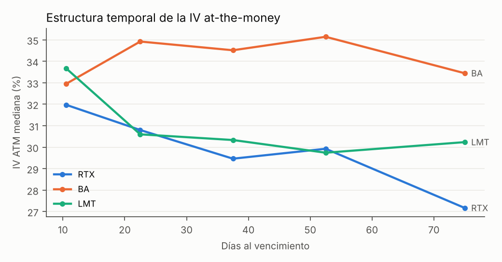

# Resumen

En la entrega parcial reportamos un P&L simulado de USD 19.055 con 97,8% de
acierto. La devolución identificó el problema: el bid y el ask eran
**sintéticos**, construidos alrededor de cierres que no son simultáneos, y la
paridad put-call trataba el dividendo como un yield continuo. Este informe
reemplaza esos resultados. Todos los números salen de los archivos de
`reportes_dolthub/`, que se reproducen con los scripts del repositorio.

Los hallazgos centrales son cuatro.

1. **Con bid y ask observados no hay arbitraje model-free ejecutable.** Sobre
   181 ruedas de la foto diaria de DoltHub (marzo a noviembre de 2026, 95.290
   cotizaciones), los detectores de monotonicidad, cota vertical, butterfly y
   calendario no encuentran **ninguna** violación. La paridad encuentra 1.744.
2. **Esas violaciones de paridad son desfase horario, no arbitraje.** La foto
   de DoltHub se toma durante la rueda y el spot de referencia es el cierre.
   Cotizando la acción en una banda del tamaño del desfase medido, las 1.744
   violaciones bajan a 3, y ninguna sobrevive a la ejecución en la rueda
   siguiente. El dividendo discreto, por su parte, elimina el 41% del edge
   fantasma de LMT en las tres semanas previas a cada fecha ex.
3. **El binomial calibrado reproduce la cadena dentro del bid-ask.** Una
   sonrisa cuadrática por vencimiento revalúa en el árbol entre el 82% y el
   93% de las opciones fuera del dinero dentro del spread, con un error
   mediano de 0,2 a 0,3 medios spreads.
4. **La estrategia de valor relativo contra el modelo pierde fuera de muestra,
   y sabemos por qué.** Publicar órdenes límite al precio del modelo menos un
   margen se llena sólo cuando el mercado atraviesa el modelo: es selección
   adversa. En el walk-forward (calibración marzo-junio, evaluación mes a mes
   de julio a noviembre) ninguna configuración alcanza un Sharpe deflactado
   de 0,95, y con más órdenes por rueda las 36 configuraciones pierden.

La estrategia de valor relativo, de payoff acotado y tamaño mínimo, es la que
corre en paper trading, porque es la única que genera posiciones sobre las que
la Parte 2 puede comparar el binomial contra Black-Scholes en producción.

# 1. Qué cambió respecto de la entrega parcial

| Devolución | Qué hicimos | Dónde |
|---|---|---|
| 1. Bid/ask real | Descarga de 181 ruedas de DoltHub con bid y ask observados; ejecución contra esos precios | `scripts/download_dolthub.py`, `ita_options/dolthub.py` |
| 2. Paridad con dividendos discretos y fondeo | Cotas americanas con dividendo discreto, fondeo asimétrico, dividendos point-in-time y banda de spot; carry y asignación anticipada en el backtest; corregido un error de signo en el préstamo de la acción | `ita_options/arbitrage.py`, `ita_options/backtest.py` |
| 3. Paper trading | Valor relativo contra el binomial en verticales y butterflies, orden multipata límite, 1 unidad, vencimientos de diciembre en adelante | `ita_options/execution/model_rv.py` |
| 4. Split IS/OOS | Walk-forward con ventana creciente desde marzo-junio y evaluación mes a mes | `ita_options/rv_backtest.py` |
| 5. Ajuste de la calibración | Sonrisa paramétrica, IV contra moneyness y plazo, RMSE de repricing dentro y fuera de muestra | `scripts/run_calibration.py` |
| 6. Monitoreo como proceso | El loop `paper-run` corre toda la rueda: marca, reconcilia el ledger con el broker y aplica los cortes sobre posiciones reales | `ita_options/execution/live_runner.py` |
| 7. Una sola versión | Este informe; la entrega parcial quedó archivada en `entrega_parcial_sep/` | — |

Además, la revisión del código encontró un error que la devolución no
mencionaba: en la conversión reversa, el costo de préstamo de la acción
**sumaba** al crédito en lugar de restar, y el medio spread de la acción tenía
el signo invertido en las dos cotas. Ambos inflaban justamente las paridades,
que eran el 87% del P&L de la entrega parcial.

# 2. Datos

## 2.1 Fuente

Alpaca no ofrece histórico de cotizaciones de opciones, y el plan gratuito de
Polygon sólo da velas. El recorder propio que planeamos en septiembre no llegó
a grabar. La fuente de bid y ask observados es la base pública
`post-no-preference/options` de DoltHub: una foto diaria de la cadena con
bid, ask, volatilidad implícita y griegas del proveedor.

| Concepto | Valor |
|---|---|
| Período | 2 de marzo a 20 de noviembre de 2026 |
| Ruedas pedidas / con datos | 185 / 181 |
| Ruedas sin datos en DoltHub | 1, 13 y 14 de mayo; 29 de septiembre |
| Cotizaciones | 95.290 (LMT 35.600, BA 31.034, RTX 28.656) |
| Vencimientos | hasta 200 días |
| Spot | cierre diario sin ajustar por dividendos (Yahoo) |
| Tasa libre de riesgo | letra a 13 semanas (^IRX), diaria; entre 3,56% y 4,15% |
| Dividendos | Polygon (con fecha de declaración) y Yahoo |

La descarga hace una consulta por rueda con los tres subyacentes, en paralelo
y con caché, y reintenta los timeouts del servidor. Las cuatro ruedas vacías
siguieron vacías en un segundo intento: son huecos de la base.

## 2.2 Curación y filtros

Cada fila se sella a las 16:00 de Nueva York de su rueda, y una señal de la
rueda $t$ se ejecuta contra la foto de $t+1$ o $t+2$. DoltHub no publica
volumen ni open interest: se reporta su ausencia, pero no se la trata como
cero ni como liquidez, y la liquidez se juzga por el spread.

| Criterio | Filas excluidas |
|---|---:|
| Spread relativo $\ge 25\%$ | 38.773 |
| Bid nulo | 7.505 |
| Mid menor a USD 0,05 | 269 |
| Cotización cruzada | 25 |
| **Explotables** | **56.492 de 95.290 (59,3%)** |

El spread relativo mediano es 18,5%. El umbral de 25% (15% en la entrega
parcial) se eligió porque con 15% se descarta más de la mitad de la cadena.

## 2.3 Desfase entre la foto y el cierre de la acción

DoltHub no documenta la hora de la foto. Para medir cuánto se separa la cadena
del cierre de la acción, en cada rueda y subyacente se estima el spot
implícito por paridad en los pares cercanos al dinero ($|\ln K/S| \le 3\%$,
entre 7 y 60 días):

$$\hat S_t = \operatorname{mediana}_{K \approx S}\left(C^{mid}_K - P^{mid}_K + K e^{-r\tau} + D\right)$$

La mediana usa en promedio 15 pares por rueda. La brecha
$|\hat S_t / S_t - 1|$ tiene mediana 0,19% y percentil 90 de 1,26%: hay días en
que la cadena cotiza contra un spot varios dólares distinto del cierre. Ese
desfase define la incertidumbre del spot, $u_t = |\hat S_t - S_t|$.

## 2.4 Dividendos point-in-time

La paridad necesita el valor presente de los dividendos con fecha ex dentro de
la vida de cada opción. Usar las fechas realizadas sería lookahead para los
dividendos todavía no anunciados. En cada rueda $t$ entran los dividendos ya
**declarados** (Polygon trae la fecha de declaración) con su monto y su fecha.
Más allá del último declarado se repite su monto cada 91 días. Por ejemplo, el
10 de marzo el modelo proyecta USD 0,68 de RTX para el 22 de mayo, y recién
desde el 30 de abril, cuando se declara el aumento, usa USD 0,73. Los
dividendos realizados se usan sólo para el P&L.

# 3. Modelo binomial y calibración

## 3.1 El árbol

Cox-Ross-Rubinstein con $N$ pasos, $\Delta t = \tau/N$:

$$u = e^{\sigma\sqrt{\Delta t}}, \qquad d = \frac{1}{u}, \qquad p = \frac{e^{(r-q)\Delta t} - d}{u - d}$$

y en cada nodo el máximo entre ejercer y continuar,

$$V_i^n = \max\left(\Psi(S_i^n),\; e^{-r\Delta t}\left[p\,V_{i+1}^{n+1} + (1-p)\,V_i^{n+1}\right]\right).$$

El dividendo discreto entra como un yield continuo equivalente: se elige $q$
tal que $S e^{-q\tau} = S - D$, de modo que el forward del árbol coincida con
el forward con dividendos discretos.

## 3.2 Calibración a la superficie

Invertir la volatilidad contrato por contrato reproduce cada precio por
construcción: el error de repricing es cero y no dice nada. La calibración que
importa es la de una **superficie paramétrica** con pocos parámetros. Por
vencimiento,

$$\sigma(k) = a + b\,k + c\,k^2, \qquad k = \ln\frac{K}{F},$$

ajustada por mínimos cuadrados ponderados por vega y por la inversa del spread,
sobre las opciones **fuera del dinero** (puts con $K<F$, calls con $K \ge F$),
que son las líquidas y las que no cargan prima de ejercicio anticipado. La IV
de cada punto se invierte con el árbol americano por Brent.

La IV americana invertida coincide con la del proveedor: la diferencia mediana
es 0,02 puntos de volatilidad sobre 2.197 contratos.




Las tres acciones muestran el skew típico de renta variable: las puts fuera
del dinero cotizan con más volatilidad que las calls. Es más pronunciado en
BA y en los plazos cortos, y se aplana con el plazo. La estructura temporal de
BA es más alta (33% a 35%) que la de RTX y LMT (27% a 34%).

## 3.3 Error de repricing

Se ajusta la sonrisa con una foto por semana (38 fotos) y se revalúa con el
árbol. Se informa el error en USD, en medios spreads ($|\hat V - m|/(s/2)$,
menor que 1 es dentro del bid-ask) y la fracción de precios dentro del spread.

| Muestra | Ajuste | Activo | Contratos | RMSE USD | Error mediano (medios spreads) | Dentro del bid-ask |
|----------------|-----------------|------|------:|------:|---------:|--------:|
| Misma foto | Superficie | BA | 1.228 | 0,44 | 0,31 | 82% |
| Misma foto | Superficie | LMT | 459 | 0,77 | 0,20 | 93% |
| Misma foto | Superficie | RTX | 510 | 0,28 | 0,24 | 84% |
| Misma foto | Sigma constante | BA | 1.228 | 0,66 | 1,12 | 46% |
| Misma foto | Sigma constante | LMT | 459 | 1,26 | 0,52 | 78% |
| Misma foto | Sigma constante | RTX | 510 | 0,49 | 1,08 | 49% |
| Rueda siguiente | Superficie | BA | 1.178 | 0,65 | 1,59 | 35% |
| Rueda siguiente | Superficie | LMT | 413 | 3,19 | 1,10 | 46% |
| Rueda siguiente | Superficie | RTX | 393 | 0,60 | 1,32 | 41% |
| Rueda siguiente | Sigma constante | BA | 1.178 | 0,56 | 1,65 | 34% |
| Rueda siguiente | Sigma constante | LMT | 413 | 2,68 | 0,73 | 57% |
| Rueda siguiente | Sigma constante | RTX | 393 | 0,54 | 1,50 | 36% |

Valores del binomial (CRR); Black-Scholes da prácticamente lo mismo
(`calibracion_rmse.csv`).

Dentro de la misma foto la superficie reproduce la cadena: entre 82% y 93% de
los precios caen dentro del bid-ask, contra 46% a 78% con una sigma única. En la
rueda siguiente la ventaja desaparece: la **forma** de la sonrisa es estable,
pero su **nivel** se mueve día a día. La consecuencia práctica es que el modelo
hay que recalibrarlo en cada foto, que es lo que hace la estrategia.

# 4. Detección de arbitrajes con bid y ask observados

## 4.1 Detectores

Los cinco detectores model-free compran al ask y venden al bid: monotonicidad
vertical, cota del spread vertical, convexidad (butterfly), paridad put-call
americana y calendario. Las correcciones al notebook de cátedra de la entrega
parcial (signo de la butterfly, patas del calendario, ask nulo, paridad
europea) se mantienen.

## 4.2 Paridad put-call corregida

Para opciones americanas sobre una acción con dividendos discretos, con $D$ el
valor presente de los dividendos con fecha ex dentro de la vida de la opción,

$$S - D - K \;\le\; C_A - P_A \;\le\; S - K e^{-r\tau}.$$

**Conversión** (viola la cota superior): se vende el call al bid, se compra la
put al ask y se compra la acción al ask, financiada a $r_b = r + s_f$. El
portafolio entrega $K$ al vencimiento, o antes si asignan el call:

$$\text{edge}_{conv} = C^{bid} - P^{ask} - S^{ask} + K e^{-r_b\tau}.$$

**Conversión reversa** (viola la cota inferior): se compra el call al ask, se
vende la put al bid y se shortea la acción al bid. Se pagan los dividendos y el
préstamo $h$, y la put vendida puede ser asignada en cualquier momento (peor
caso: pagar $K$ hoy):

$$\text{edge}_{rev} = S^{bid} - D - K - \left(C^{ask} - P^{bid}\right) - h\,S^{bid}\tau.$$

La acción se cotiza en la banda $S^{bid,ask} = S \mp (\tfrac{s}{2} + u_t)$:
una violación tiene que superar el desfase horario de la foto para contar. Se
usa $s_f = h = 0{,}5\%$ anual.

## 4.3 Cuánto aporta cada corrección

| Supuesto | Violaciones de paridad | Ruedas con violaciones | Edge mediano |
|---|---:|---:|---:|
| Yield continuo, sin banda | 1.744 | 76 | USD 92,5 |
| Dividendo discreto, sin banda | 1.737 | 72 | USD 92,5 |
| Dividendo discreto y banda de spot | 3 | 2 | USD 13,3 |

Los otros cuatro detectores no encuentran ninguna violación en las 181 ruedas.

En el agregado el dividendo discreto parece no pesar, porque el desfase
horario domina. Su efecto aparece donde tiene que aparecer: en las
conversiones reversas que atraviesan una fecha ex, durante las tres semanas
previas.

| Subyacente | Supuesto | Conversiones reversas | Edge fantasma total |
|---|---|---:|---:|
| LMT | Yield continuo | 26 | USD 7.933 |
| LMT | Dividendo discreto | 18 | USD 4.704 |
| RTX | Yield continuo | 72 | USD 7.230 |
| RTX | Dividendo discreto | 56 | USD 4.391 |

Es el mecanismo que disparó el kill-switch en la paridad de LMT de la entrega
parcial: el yield continuo subestima el dividendo trimestral de USD 3,45 cerca
de la fecha ex, y la diferencia aparece como arbitraje.

## 4.4 Backtest con carry

El backtest ejecuta contra la foto de la rueda siguiente, sólo si cada pata
tiene cotización ese día y el edge recalculado con esos precios sigue siendo
de al menos USD 5. Ahora cobra el **carry** de la tenencia:

- intereses sobre la caja neta de entrada, a $r + s_f$ si es débito y a
  $r - s_f$ si es crédito, con la tasa ^IRX del día de apertura;
- préstamo de la acción vendida en corto;
- dividendos realizados con fecha ex durante la tenencia, cobrados por la
  acción comprada y pagados por la vendida;
- **asignación anticipada**: la víspera de una fecha ex, si el call corto
  está en el dinero y su valor temporal es menor que el dividendo, se lo
  asigna y la posición se liquida.

| Ejecución | Señales | Ejecutadas | Edge desaparecido | Sin cotización |
|---|---:|---:|---:|---:|
| Foto de $t+1$ | 3 | 0 | 2 | 1 |
| Foto de $t+2$ | 3 | 0 | 1 | 2 |

**No hay operaciones.** El 97,8% de acierto de la entrega parcial no bajó a
"algo creíble": desapareció, porque las operaciones que lo producían eran
artefactos del bid/ask sintético y de los cierres no simultáneos. Es la
respuesta que esperábamos de un mercado de opciones listadas razonablemente
eficiente, con spreads de 18% en la mediana.

# 5. Estrategia de valor relativo contra el modelo

## 5.1 Por qué

Sin arbitraje model-free ejecutable, esperar uno dejaría la cuenta paper sin
posiciones, y la Parte 2 necesita posiciones vivas para comparar el binomial
contra Black-Scholes. La estrategia que opera es de valor relativo: compra o
vende verticales y butterflies cuando el mercado se aparta de la sonrisa
calibrada. **No es un arbitraje.** Su edge depende de que el modelo sea el
precio justo.

## 5.2 Regla

En cada foto y para cada vencimiento de 21 a 75 días se ajusta la sonrisa del
modelo (sección 3.2) y se valúa cada estructura candidata cerca del dinero
($|\ln K/F| \le 12\%$): verticales de strikes contiguos y butterflies
simétricas. Con $V$ el valor del modelo y $m$ el margen pedido (neto de
comisiones), se publica una orden límite **dentro** del spread:

$$L_{compra} = V - m, \qquad L_{venta} = V + m, \qquad \text{sólo si } bid_{neto} < L < ask_{neto}.$$

Si la orden se llena, el edge contra el modelo es $m$ por construcción. Se
priorizan las órdenes más cercanas al lado contrario del spread.

**Modelo de llenado (backtest).** Con una foto por rueda, la orden publicada
en $t$ se llena en $t+1$ sólo si esa foto la cruza: para comprar, el ask neto
tiene que ser $\le L$; para vender, el bid neto $\ge L$. Es conservador,
porque una orden real puede llenarse con cualquier cruce intradía.

**Salidas.** Convergencia, cuando la ganancia después de cruzar el spread de
salida alcanza una fracción del edge; kill-switch, cuando la pérdida medida
contra el mid supera una fracción de la pérdida máxima de la estructura; o
vencimiento, liquidando por valor intrínseco. El kill-switch mide contra el
mid y no contra el valor de liquidación: medido así, se disparaba el mismo
día del fill por el solo costo de cruzar un spread del 20%.

## 5.3 Walk-forward

**Grilla declarada antes de mirar resultados** ($3 \times 3 \times 2 = 18$
configuraciones por modelo): margen $m \in \{5, 10, 20\}$ USD, convergencia
$\in \{50\%, 100\%, \text{sin}\}$ del edge, kill-switch $\in \{50\%, \text{sin}\}$
de la pérdida máxima. Fijos: 2 órdenes nuevas por rueda, hasta 10 posiciones.

**Esquema.** Ventana in-sample creciente que arranca con marzo-junio. En cada
paso se elige la configuración con mayor P&L in-sample (con al menos 5
operaciones) y se la evalúa en el mes siguiente. Las posiciones in-sample se
cierran a mercado al final de su ventana, así que ninguna atraviesa el corte.
Las del mes fuera de muestra corren hasta su vencimiento y su P&L se atribuye
al mes de apertura.

| Modelo | Mes OOS | Configuración elegida | Op. IS | P&L IS | Órdenes OOS | Op. OOS | P&L OOS |
|------|------------|-------------------------------|-----:|-------:|------:|-----:|-------:|
| CRR | julio | $m$=20, conv. 50%, sin stop | 11 | 107 | 44 | 5 | 636 |
| CRR | agosto | $m$=20, conv. 50%, sin stop | 16 | −999 | 42 | 0 | 0 |
| CRR | septiembre | $m$=20, conv. 50%, sin stop | 16 | −98 | 40 | 2 | 189 |
| CRR | octubre | $m$=20, conv. 100%, sin stop | 18 | 333 | 44 | 1 | −1.449 |
| CRR | noviembre | $m$=20, sin conv., sin stop | 19 | 1.018 | 28 | 0 | 0 |
| BSM | julio | $m$=20, conv. 50%, sin stop | 10 | −74 | 44 | 4 | 1.134 |
| BSM | agosto | $m$=20, conv. 50%, sin stop | 14 | −1.182 | 42 | 0 | 0 |
| BSM | septiembre | $m$=20, conv. 50%, sin stop | 14 | 222 | 40 | 2 | 190 |
| BSM | octubre | $m$=20, conv. 100%, sin stop | 16 | 654 | 44 | 0 | 0 |
| BSM | noviembre | $m$=20, sin conv., sin stop | 16 | 1.340 | 28 | 0 | 0 |

P&L en USD por estructura de una unidad. Fuera de muestra: CRR 8 operaciones y
USD −624; BSM 6 operaciones y USD +1.324.

**Muestra completa, las 18 configuraciones.** Binomial: 19 operaciones en
cada configuración y P&L de USD −3.472 a −430; Sharpe anualizado de −1,29 a
−0,14. Black-Scholes:
de 16 a 20 operaciones y P&L de USD −2.947 a +1.340; Sharpe de −1,16 a 0,50.
El Sharpe deflactado ($N=18$, Bailey y López de Prado, 2014) va de 0,04 a 0,23
en el binomial y de 0,04 a 0,35 en Black-Scholes: **ninguna configuración se
distingue de una búsqueda sobre ruido**. En todas, la versión con kill-switch
pierde más que la versión sin él.

## 5.4 Selección adversa

Con 2 órdenes por rueda se publican 358 órdenes en nueve meses y se llenan
entre 16 y 20 (≈5%): la potencia estadística es mínima. Para estudiar el
mecanismo corrimos, **después** de ver esos resultados, una sensibilidad con 10
órdenes por rueda. Se declara como exploratoria: no se usa para elegir
hiperparámetros y sus 36 configuraciones suman al $N$ del Sharpe deflactado
($N = 72$).

| Modelo | Operaciones | P&L total (rango) | Acierto (rango) | Sharpe (rango) |
|---|---|---|---|---|
| CRR | 59 a 82 | USD −18.667 a −7.454 | 20% a 46% | −3,56 a −1,19 |
| BSM | 56 a 77 | USD −17.884 a −6.222 | 20% a 43% | −3,58 a −1,20 |

**Las 36 configuraciones pierden.** Es la firma de la selección adversa
(Glosten y Milgrom, 1985): una orden pasiva al precio del modelo se llena
justamente cuando el mercado atraviesa ese precio, es decir, cuando hay
información nueva que el modelo, calibrado en la foto anterior, todavía no
incorporó. El edge contra el modelo existe en el momento del fill, pero es
edge contra un precio viejo.

## 5.5 Binomial contra Black-Scholes

Las dos versiones toman casi las mismas operaciones y obtienen resultados
parecidos. No es una casualidad: cada modelo se calibra a la sonrisa del
mercado **en su propio espacio de volatilidad**, y en estructuras cercanas al
dinero, de 21 a 75 días, la diferencia entre la valuación americana y la
europea se absorbe casi entera en la sonrisa ajustada. Donde el árbol debería
diferenciarse es en las puts en el dinero y en los calls de RTX y LMT cerca de
las fechas ex. Esa es la comparación que la Parte 2 tiene que hacer en
producción, con las posiciones del paper.

# 6. Paper trading y monitoreo

## 6.1 Qué corre

`paper-run --strategy rv_crr` en la cuenta paper de Alpaca (opciones nivel 3).
En cada ciclo, cada 120 segundos durante la rueda:

1. **Datos.** Spot, universo de contratos (una vez por rueda) y cotizaciones;
   arma la cadena con los filtros de liquidez y descarta las cotizaciones
   viejas.
2. **Corte manual.** Si existe el archivo `KILL`, detiene las entradas y
   cierra todo.
3. **Gestión de posiciones.** Marca cada estructura al lado de cierre del NBBO
   y la cierra por kill-switch, por convergencia o antes del vencimiento. Si la
   pérdida diaria supera el límite, detiene las entradas y cierra todo.
4. **Reconciliación.** Compara el ledger SQLite con las posiciones del broker;
   si difieren dos ciclos seguidos, detiene las entradas.
5. **Entradas.** Ajusta la sonrisa del binomial, elige como máximo 2
   estructuras y envía una orden `mleg` límite al precio del modelo menos el
   margen, que espera hasta 180 segundos antes de cancelarse.

| Parámetro | Valor |
|---|---|
| Estructuras | verticales y butterflies (payoff acotado) |
| Tamaño | 1 unidad |
| Vencimientos | 21 a 75 días (diciembre de 2026 en adelante) |
| Edge mínimo contra el modelo | USD 10 |
| Convergencia | 60% del edge |
| Kill-switch | USD 250 de pérdida no realizada por estructura |
| Pérdida diaria máxima | USD 1.000 |
| Posiciones simultáneas | 6 |

## 6.2 Estado

El 22 de noviembre el diagnóstico (`doctor`) verificó autenticación, permisos
de opciones nivel 3, universo de 3.678 contratos y NBBO en vivo. La primera
rueda prevista es la del 23 de noviembre. El reporte de cada sesión queda en
`reportes/paper/session_<fecha>/`, con las órdenes, los fills, las
reconciliaciones y los eventos del kill-switch. **El P&L acumulado en paper se
agrega a este informe a medida que haya ruedas operadas.**

Dado el resultado de la sección 5.4, esperamos que la estrategia pierda. La
consigna no evalúa el retorno, y el objetivo del paper es otro: medir en
producción la tasa de llenado y la selección adversa, y tener posiciones sobre
las que comparar el binomial contra Black-Scholes en la Parte 2.

# 7. Limitaciones

- **Una foto por rueda, sin hora documentada.** El desfase con el cierre se
  mide y se absorbe con la banda de spot, pero no se elimina. El modelo de
  llenado ve un solo precio por día.
- **Sin volumen ni open interest.** La liquidez se juzga sólo por el spread.
- **Cuatro ruedas sin datos** en DoltHub (1, 13 y 14 de mayo; 29 de septiembre).
- **Poca potencia estadística** en la estrategia de valor relativo con la
  grilla declarada (16 a 20 operaciones en nueve meses).
- **Dividendo como yield equivalente** en el árbol: correcto para el forward,
  aproximado para el ejercicio anticipado alrededor de la fecha ex.
- **El paper de Alpaca** no simula slippage, impacto, dividendos ni costo de
  préstamo, y el feed gratuito (`indicative`) llega demorado.
- **Asignación anticipada de la put vendida** en la conversión reversa: el
  detector la cubre con la cota de peor caso, pero el backtest no la simula.

# 8. Literatura

- **Cox, Ross y Rubinstein (1979)**, "Option Pricing: A Simplified Approach",
  *Journal of Financial Economics*. Es el árbol que usamos para valuar e
  invertir la IV americana.
- **Hull**, *Options, Futures, and Other Derivatives*, capítulo de
  propiedades de las opciones. Da las cotas americanas de la paridad con
  dividendos discretos de la sección 4.2.
- **Ofek, Richardson y Whitelaw (2004)**, "Limited Arbitrage and Short Sales
  Restrictions: Evidence from the Options Markets", *Journal of Financial
  Economics*. Las violaciones de paridad se concentran donde vender en corto es
  caro o imposible: el costo de préstamo es parte del edge, no un detalle.
- **Gatheral (2006)**, *The Volatility Surface*. Sostiene la parametrización de
  la sonrisa en log-moneyness y la distinción entre invertir y calibrar.
- **Bailey y López de Prado (2014)**, "The Deflated Sharpe Ratio", *Journal of
  Portfolio Management*. Es el ajuste por cantidad de configuraciones probadas.
- **López de Prado (2018)**, *Advances in Financial Machine Learning*. Purga y
  embargo entre muestras, que aplicamos cortando las posiciones in-sample al
  final de su ventana.
- **Glosten y Milgrom (1985)**, "Bid, Ask and Transaction Prices in a
  Specialist Market with Heterogeneously Informed Traders", *Journal of
  Financial Economics*. Explica por qué una orden pasiva al precio del modelo
  se llena en contra (sección 5.4).

# 9. Reproducibilidad

Desde `ita_options_pipeline/`:

```text
pip install -e ".[dev]"
python -m pytest
python scripts/download_dolthub.py --start 2026-03-02 --end 2026-11-20
python scripts/run_dolthub_analysis.py --out reportes_dolthub
python scripts/run_calibration.py --out reportes_dolthub
python scripts/run_rv_sensitivity.py --out reportes_dolthub
python scripts/check_informe.py
```

`check_informe.py` verifica que cada número clave de este informe coincida con
los archivos de `reportes_dolthub/`.
